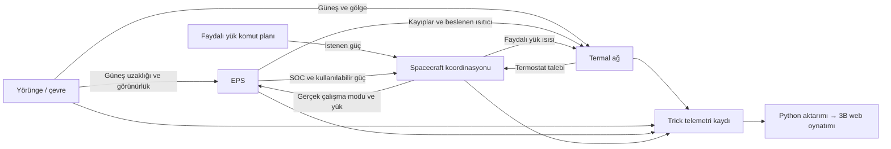

# Model ve zamanlama



## Sürekli yörünge, örneklenmiş alt sistemler

Yörünge RK4 ile 1 saniyelik adımlarda integre edilir. Altı konum/hız durumuna
bozucu kuvvet iş integrali eklenir. RK4 ara adımlarında çevre doğru ara zamanda
hesaplanır. İş kalıntısı ile fiziksel enerji değişimi birbirinden ayrılır.

EPS ve faydalı yük 1 Hz örneklenmiş modeldir. Her `t` anında:

1. Önceki `[t-1,t)` aralığı için hesaplanan sabit güçlerle batarya enerjisi ilerletilir.
2. Yeni `t` anının çevre bilgisi ve faydalı yük komutu okunur.
3. Düşük SOC durumu histerezisle güncellenir.
4. Batarya sıcaklığına göre termostat güncellenir. Öncelik platform, ısıtıcı, faydalı yüktür. Güç talebi ve kullanılabilir güçten gerçek faydalı yük modu seçilir.
5. Bir sonraki bir saniye boyunca tutulacak güçler hesaplanır.

Başlangıçta `dt=0`: henüz enerji tüketilmez. Görünürlükteki değişimler 1 Hz
örneklenir; 5 saniyelik CSV kaydı tüm geçiş anlarını tam çözünürlükte göstermez.
Kamera animasyonu kaydedilen konumu aradeğerler; çalışma modları kesikli tutulur.

## EPS denklemleri

```text
P_panel = 1361 W/m² × (AU/d)² × A_panel × eta_panel × cos_theta × eta_reg × görünürlük
P_panel + P_discharge = P_load + P_charge + P_curtailed
Delta E_Wh = (eta_charge × P_charge - P_discharge / eta_discharge - I²R) × dt / 3600
SOC = E_Wh / (capacity_Wh × capacity_soh)
```

Şarj/deşarj güçleri dönüştürücü sınırlarıyla ve bir sonraki aralıkta batarya
enerjisinin 0..kapasite sınırında kalması koşuluyla kısıtlanır. Dolu bataryada
artan enerji `curtailed_w` olarak kaydedilir; kaybolmuş sayılmaz. Boş bataryada
talep karşılanamazsa `unserved_w` artar. Gerilim/akım sentetik açık devre gerilimi ve seri dirençten hesaplanır; Wh değerleri
Trick'te boyutsuz birim açıklamasıyla, isimlerinde açık Wh etiketiyle tutulur.

Enerji doğrulaması:
`E-E0 = harvested - supplied - curtailed - conversion_losses (dönüştürücü + I²R)`.
Panelden önceki optik/PV kayıpları elektrik enerjisi dengesi kapsamı dışındadır;
`solar_w` regülatör çıkışıdır. Batarya I²R kaybı batarya düğümüne, batarya dönüştürücü kaybı gövdeye aktarılır.
PV/regülatör öncesi kayıplar termal ağa dahil değildir.

## Faydalı yük ve yük yönetimi

- Komut: 600. saniyeden başlayarak her 1800 saniyede 900 saniye çalışma isteği.
- Aktif: 28 W; bekleme: 2 W; kapalı: 0 W.
- Platform taban yükü: 8 W, önceliklidir.
- SOC ≤ %20: aktif faydalı yük engellenir. SOC ≥ %35: yeniden izin verilir.
- Aktif yük için güç yetmezse bekleme; bekleme için de yetmezse kapalı.
- Talep ve gerçek tüketim ayrı alanlardır. Düşük enerjiyle engellenmiş komut,
  aktif çalışma süresine eklenmez.

Bu bir görev yönetimi gösterimidir; gerçek BMS, EPS elektroniği, platform kapanışı,
reset veya komut kuyruğu modeli değildir.

## Ortam varsayımları

J2 ve merkezi çekim; 150–1000 km deney aralığında nominal üstel atmosfer ve
birlikte dönen hava; sabit etkin alanlı sürükleme/ışınım; küresel Dünya ile Güneş
örtüşmesi; NASA/JPL DE441 geometrik Dünya merkezli ICRF Güneş/Ay verileri.

Dünya kutbu sabit referans Z eksenine yaklaşık hizalanır. EOP/presesyon/nütasyon,
yüksek dereceli gravite ve uzay hava durumu yoktur. İrtifa küresel `|r|-R` değeridir.
Paketli veri başlangıcı 2026-10-16 00:00:00 TDB; kapsam 172800 saniyedir.
TDB yerel saat/UTC değildir. Verinin dışına sessiz ekstrapolasyon yapılmaz.

EPS için Güneş ve gölge her zaman hesaplanır; `use_sun=False` yalnızca Güneş'in
çekim katkısını kapatır. `use_srp=False` da panel üretimini değil ışınım ivmesini kapatır.

EPS panel alanı ile sürükleme/SRP etkin alanları ayrı girdilerdir. Henüz tek bir
geometri/yönelim modelinden türetilmezler. Böyle bir bağlantı ADCS/alan modelinin
ileride eklenmesiyle kurulacaktır.


## Rint devre bağlantısı (M1.1)

Açık devre gerilimi `Voc=Vempty+(Vfull-Vempty)*SOC`.
Pozitif deşarj akımı için `Vterminal=Voc-I*R`, bus'a aktarılan güç
`eta_discharge*(Voc*I-R*I²)` olur. Şarjda akım işareti negatiftir ve terminal
voltajı yükselir. Akım, güç denkleminin düşük akımlı fiziksel kökünden bulunur.
Depolama enerjisinin değişimi `-Voc*I*dt` ile hesaplanır; I²R ayrıca kayıp olarak
kaydedilir. Direnç 0 olduğunda önceki ideal verim modeline geri döner.

Kullanılabilir enerji oranı ile doğrusal gerilim eşlemesi bir eğitim yaklaşımıdır;
gerçek batarya yük-SOC eğrisi değildir. Parametreler ve sınırlar PARAMETERS.md'dedir.

## Termal zamanlama (M2)

Önceki aralığın güçleriyle üç sıcaklık, 1 saniyelik RK4 adımıyla ilerletilir.
İletim ve T⁴ ışınımı her ara aşamada yeniden hesaplanır; dış kaynaklar aralık boyunca sabittir.
Sonra yeni termostat ve elektrik dağıtımı belirlenir. Ayrıntılar: [Termal model](THERMAL.md).
